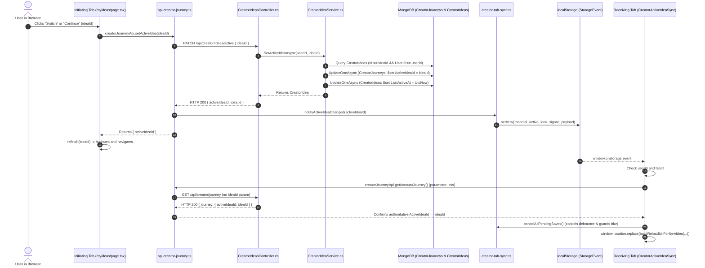

# End-to-End Source-Code Audit: Creator Idea Selection, ActiveIdeaId, Storage, Hydration & Scoping

**Repository**: `MondialECO/mondial_monorepo_fullstack`
**Current Branch**: `dev-hafiz`
**HEAD SHA**: `371c0d4be83bc6d221374fa8f049fa5c251214c8`
**Audit Scope**: Historical Baseline Analysis vs. Approved Single-Active-Idea Implementation
**Audit Date**: 2026-10-01

---

## 1. Repository State & Baseline Alignment

### 1.1 Historical Baseline vs. Current Working Tree
- **Historical Baseline**: Commit `371c0d4be83bc6d221374fa8f049fa5c251214c8` (`fix(creator): remove redundant brand studio metadata strip from launch assets view`).
  - At this baseline commit, Creator browser tabs were completely isolated; no cross-tab communication or synchronization existed.
  - `git diff 371c0d4b -- backend` confirms **zero modifications to any backend file**, configuration, API contract, or database schema.
- **Current Approved Implementation**:
  - Implements the approved single-active-idea behavior across Creator workspace tabs using frontend-only coordination.
  - Integrates `src/lib/creator-tab-sync.ts` and `src/components/creator/CreatorActiveIdeaSync.tsx`.
  - Reconciles query parameter parsing (`?ideaId=` and legacy `?idea=`) and introduces `creatorJourneyApi.getAccountJourney()` in `src/lib/api-creator-journey.ts`.
  - Adds save-cancellation registration in `src/hooks/useCreatorProgressState.ts` and reload guards in `PricingStrategyView.tsx` and `phase-3/formation/page.tsx`.
  - Unit-tested via `src/__tests__/creator/creator-tab-sync.test.ts` (6 tests passing).

---

## 2. Inventory of Project Identity Sources

### 2.1 Storage Read/Write Matrix

| Storage Mechanism | Exact Key | Actual Payload Shape | Writer Functions & Triggers | Reader Functions & Triggers | Scope | Expiry / Invalidation / Fallback |
| :--- | :--- | :--- | :--- | :--- | :--- | :--- |
| **`localStorage` (Current Implementation)** | `'mondial_active_idea_signal'` | `{ ideaId: string, userId: string \| null, timestamp: number, tabId: string }` | [`src/lib/creator-tab-sync.ts`](file:///e:/17-07-2026/mondial_monorepo_fullstack/src/lib/creator-tab-sync.ts) via `notifyActiveIdeaChanged()` on `setActiveIdea()` or `createIdea()` | [`src/components/creator/CreatorActiveIdeaSync.tsx`](file:///e:/17-07-2026/mondial_monorepo_fullstack/src/components/creator/CreatorActiveIdeaSync.tsx) on window `storage` event | Cross-tab (same origin & browser profile) | Lightweight notification payload only. **Not the authoritative selection.** Receiving tabs re-verify the selection from the server via `getAccountJourney()`. |
| **`sessionStorage`** | `'creator_workspace_idea_id'` | Raw string, e.g. `"64f1a2b3c4d5e6f7a8b9c0d1"` | [`useCreatorProgressState.ts`](file:///e:/17-07-2026/mondial_monorepo_fullstack/src/hooks/useCreatorProgressState.ts) on successful `hydrate()` | [`useCreatorProgressState.ts`](file:///e:/17-07-2026/mondial_monorepo_fullstack/src/hooks/useCreatorProgressState.ts) in `hydrate()` | Tab-local (isolated to the browser tab) | Cleared on logout ([`AuthProvider.tsx`](file:///e:/17-07-2026/mondial_monorepo_fullstack/src/app/_providers/AuthProvider.tsx)); removed on 404 recovery or when workspace is null. Stale workspace recovery derives replacement from `journey.activeIdeaId`. |
| **`localStorage` (Cache)** | `'mondial_creator_progress_draft'` | `{ journeyState: { phase1, phase2, phase3, phase4, phase5, phase6 } }` | [`useCreatorProgressState.ts`](file:///e:/17-07-2026/mondial_monorepo_fullstack/src/hooks/useCreatorProgressState.ts) via `trimForCache(state)` on debounced progress changes | [`useCreatorProgressState.ts`](file:///e:/17-07-2026/mondial_monorepo_fullstack/src/hooks/useCreatorProgressState.ts) via `readCache()` upon initial component mount only | Browser-wide (all tabs for origin) | **Does NOT contain `activeIdeaId`**. Stripped by `trimForCache()`. Cleared on logout. |
| **`localStorage` (Historical Legacy)** | `'activeIdeaId'` | Raw string (if present) | **None in codebase.** (Orphaned legacy read) | [`src/app/dashboard/creator/phase-2/complete/page.tsx`](file:///e:/17-07-2026/mondial_monorepo_fullstack/src/app/dashboard/creator/phase-2/complete/page.tsx) as fallback expression | Browser-wide | Never written by any active code; returns `null`/`undefined`. |
| **`localStorage`** | `'mondial_forecast_budget_${ideaId}'` | String representation of number (e.g. `"50000"`) | [`src/app/dashboard/creator/phase-3/forecast/page.tsx`](file:///e:/17-07-2026/mondial_monorepo_fullstack/src/app/dashboard/creator/phase-3/forecast/page.tsx) on forecast input change | [`src/app/dashboard/creator/phase-3/forecast/page.tsx`](file:///e:/17-07-2026/mondial_monorepo_fullstack/src/app/dashboard/creator/phase-3/forecast/page.tsx) on mount | Idea-scoped | Persists across tabs for the exact `ideaId`. Cleared on logout (`localStorage.clear()`). |
| **`localStorage`** | `'token'` / `'user'` | JWT string / Serialized JSON User object | [`AuthProvider.tsx`](file:///e:/17-07-2026/mondial_monorepo_fullstack/src/app/_providers/AuthProvider.tsx) on login | [`AuthProvider.tsx`](file:///e:/17-07-2026/mondial_monorepo_fullstack/src/app/_providers/AuthProvider.tsx) on mount and `storage` event | Account-scoped | Cleared on logout or 401 interceptor. Triggers tab logout via window `storage` event. |
| **Module Heap Variable** | `workspaceIdeaId` | `string \| null` | [`src/lib/api-creator-journey.ts`](file:///e:/17-07-2026/mondial_monorepo_fullstack/src/lib/api-creator-journey.ts) via `setCreatorWorkspaceIdea(ideaId)` | [`src/lib/api-creator-journey.ts`](file:///e:/17-07-2026/mondial_monorepo_fullstack/src/lib/api-creator-journey.ts) in `resolveIdeaId` and default `creatorJourneyApi.get` | Tab-local (isolated in tab's JS memory) | Cleared by `resetCreatorWorkspace()` on logout or on 404 recovery. **Bypassed completely by `creatorJourneyApi.getAccountJourney()`.** |
| **Module Heap Map** | `ideaVersions` | `Map<string, number>` | [`src/lib/api-creator-journey.ts`](file:///e:/17-07-2026/mondial_monorepo_fullstack/src/lib/api-creator-journey.ts) on `rememberIdeaVersion` and `setIdeaVersion` | [`src/lib/api-creator-journey.ts`](file:///e:/17-07-2026/mondial_monorepo_fullstack/src/lib/api-creator-journey.ts) in `withIdeaWrite` and `getIdeaVersion` | Tab-local | Cleared by `resetCreatorWorkspace()` on logout. Preserves optimistic concurrency version tokens. |
| **React Context State** | `state.activeIdeaId` | `string \| null` | [`useCreatorProgressState.ts`](file:///e:/17-07-2026/mondial_monorepo_fullstack/src/hooks/useCreatorProgressState.ts) via `reconcile()` | Consumed by `useCreatorProgress()` in all subscribed components | Tab-local | Re-evaluated on `hydrate()` or `refetch()`. |
| **URL Query Parameter** | `?ideaId={id}` | Query string | Navigation links in `AppSidebar`, `withIdeaContext`, `router.push` | Page components via `useSearchParams().get('ideaId')` and `useCreatorProgressState.ts` | Route/Tab-local | Controls page view rendering directly. Reconciled during hydration and tab synchronization. |
| **URL Query Parameter (Legacy)** | `?idea={id}` | Query string | Legacy deep links | [`useCreatorProgressState.ts`](file:///e:/17-07-2026/mondial_monorepo_fullstack/src/hooks/useCreatorProgressState.ts) | Route/Tab-local | Handled alongside `?ideaId=`; removed and upgraded to `?ideaId=` on reload. |
| **MongoDB Document** | `CreatorJourneys.ActiveIdeaId` | `string` (ObjectId format) | [`CreatorIdeaService.cs`](file:///e:/17-07-2026/mondial_monorepo_fullstack/backend/Services/Implementations/CreatorIdeaService.cs) via `SetActivePointerAsync` | [`CreatorJourneyService.cs`](file:///e:/17-07-2026/mondial_monorepo_fullstack/backend/Services/Implementations/CreatorJourneyService.cs) in `TryResolveIdeaAsync` | Account-level (1 document per user) | **Authoritative active idea selection.** Updated only by explicit switch (`PATCH /api/creator/ideas/active`) or new idea creation (`POST /api/creator/ideas`). |

---

## 3. Explicit Selection Trace: UI to Database & Notification



### Detailed Observations on Selection:
1. **Origin of ID**: The `ideaId` originates from the card rendered in `myideas/page.tsx` (derived from `creatorJourneyApi.listIdeas()`).
2. **Authoritative Account Selection**: MongoDB collection `CreatorJourneys`, field `ActiveIdeaId` (keyed uniquely by `UserId`).
3. **Notification Signal vs. Authoritative Selection**:
   - `mondial_active_idea_signal` in `localStorage` is **purely a lightweight notification signal** (`{ ideaId, userId, timestamp, tabId }`).
   - It is NOT the authoritative selection.
   - Other tabs NEVER blindly trust the payload value; upon receiving the signal, they issue a parameter-less `creatorJourneyApi.getAccountJourney()` to fetch the authoritative `CreatorJourneys.ActiveIdeaId` directly from the server.
4. **Does Reading Change the Selection?**: **NO.** Calling `GET /api/creator/journey` or `GET /api/creator/journey?ideaId=xxx` does NOT mutate `CreatorJourneys.ActiveIdeaId`.
5. **Existing Idea-Scoped Reads Remain Supported**: Calling `creatorJourneyApi.get(ideaId)` or page-level idea-scoped endpoints (e.g. `getPricingStrategy(ideaId)`) remains fully supported for scoped queries.

---

## 4. Initial Load, Hydration & URL Reconciliation

### 4.1 Decoupled Account Journey Reads: `creatorJourneyApi.getAccountJourney()`
In the historical baseline, `creatorJourneyApi.get()` without arguments fell back to `ideaId ?? workspaceIdeaId`. If `workspaceIdeaId` was set, calling `get()` sent `{ params: { ideaId: workspaceIdeaId } }` rather than fetching the account-level selection.

In the current implementation:
- **`creatorJourneyApi.getAccountJourney()`** is introduced:
  ```typescript
  getAccountJourney: async (): Promise<JourneyResponse> => {
    const res = await api.get('/creator/journey');
    const data = unwrap<JourneyResponse>(res.data);
    if (data.journey.activeIdeaId && data.journey.ideaVersion > 0) {
      ideaVersions.set(data.journey.activeIdeaId, data.journey.ideaVersion);
    }
    return data;
  }
  ```
  This makes an explicit parameter-less request, guaranteeing retrieval of the authoritative account selection without injecting any cached workspace ID.
- **`creatorJourneyApi.get(ideaId?, { accountOnly?: boolean })`**: Allows callers to explicitly request the account journey or an idea-scoped journey.

### 4.2 Hydration in `useCreatorProgressState`
- **Query Parameter Support**: Parses both `searchParams.get('ideaId')` and legacy `searchParams.get('idea')`.
- **Initial Hydration Path**:
  - Initial load/reload resolves `creatorJourneyApi.getAccountJourney()` first unless an explicit `requestedIdeaId` was passed into `refetch(id)`.
  - Stale URL Alignment: If a Creator page is opened with an outdated `?ideaId=A` while the account's authoritative active idea is `B`, it cleanly reloads to `?ideaId=B` via `buildReloadUrlForNewIdea` and `window.location.replace`.
- **Stale Workspace Recovery Bug Fix**:
  - When recovering from a stale `sessionStorage` reference (e.g. deleted idea), `workspaceIdeaId` is derived from the successfully loaded `journey.activeIdeaId` rather than reusing the failed requested ID.

### 4.3 Precedence & Scenario Matrix

| Initial State Scenario | Historical Baseline Behavior | Current Approved Implementation Behavior |
| :--- | :--- | :--- |
| **No URL ideaId (fresh tab)** | Hydrated backend `journey.activeIdeaId`. | Hydrates backend `journey.activeIdeaId` via `getAccountJourney()`. Sets `sessionStorage` and workspace memory. |
| **URL has `?ideaId=A`, backend has `B`** | Split-brain: Provider hydrated `A` or backend default; page view rendered `A`. | Provider fetches authoritative `B` via `getAccountJourney()`. Detects URL mismatch on `/dashboard/creator/**`, reloads via `window.location.replace` to `?ideaId=B`. |
| **URL has legacy `?idea=B`** | Parsed by provider, ignored by page views. | Parsed by provider, upgraded to `?ideaId=B` on URL reconstruction. |
| **Another tab switches to `B`** | Tab remained on `A` indefinitely; no reload or signal. | Tab receives storage signal, re-reads backend selection (`B`), cancels pending saves, discards uncommitted inputs, and reloads current route to `?ideaId=B`. |
| **Deleted/Unowned Idea in `sessionStorage`** | Threw 404; recovered default, but assigned workspace to failed ID. | Threw 404; recovers default via `getAccountJourney()`, derives workspace ID from `journey.activeIdeaId`. |

---

## 5. Active Creator Page Consumers Matrix

| Page / Route | Initial Read ID | Displayed Content ID | Mutate / Save / Generate ID | Optimistic Concurrency Key | Cross-Tab Sync Reload Behavior |
| :--- | :--- | :--- | :--- | :--- | :--- |
| **Creator Dashboard** (`/dashboard/creator`) | `state.activeIdeaId` | `state.activeIdeaId` | `createIdea()` | `['creator', 'dashboardSummary']` | Reloads to `/dashboard/creator?ideaId={B}` |
| **My Ideas** (`/myideas`) | None (lists all owned ideas) | All owned ideas | `setActiveIdea()` / `createIdea()` | `['creator', 'myIdeas']` | Updates list; initiates sync signal |
| **Phase 4 Snapshot** (`/phase-4`) | `searchParams.get('ideaId') \|\| state.activeIdeaId` | `effectiveIdeaId` | `generateConstructionSnapshot()` | `ideaVersions.get(effectiveIdeaId)` | Reloads to `/phase-4?ideaId={B}` |
| **Phase 4 Roadmap** (`/phase-4/roadmap`) | `searchParams.get('ideaId') \|\| state.activeIdeaId` | `effectiveIdeaId` | `updateRoadmapTask()` | `ideaVersions.get(effectiveIdeaId)` | Reloads to `/phase-4/roadmap?ideaId={B}` |
| **Phase 4 Needs** (`/phase-4/needs`) | `searchParams.get('ideaId') \|\| state.activeIdeaId` | `effectiveIdeaId` | `confirmNeed()` | `ideaVersions.get(effectiveIdeaId)` | Reloads to `/phase-4/needs?ideaId={B}` |
| **Phase 4 Skills** (`/phase-4/skills`) | `searchParams.get('ideaId') \|\| state.activeIdeaId` | `effectiveIdeaId` | `resolveSkill()` | `ideaVersions.get(effectiveIdeaId)` | Reloads to `/phase-4/skills?ideaId={B}` |
| **Phase 4 Support** (`/phase-4/support`) | `searchParams.get('ideaId') \|\| state.activeIdeaId` | `effectiveIdeaId` | `saveSupportPlan()` | `ideaVersions.get(effectiveIdeaId)` | Reloads to `/phase-4/support?ideaId={B}` |
| **Phase 4 Pricing** (`/phase-4/pricing`) | `searchParams.get('ideaId') \|\| state.activeIdeaId` | `effectiveIdeaId` | `updatePricingOffer()` | `ideaVersions.get(effectiveIdeaId)` | Cancels price blur/save; reloads to `/pricing?ideaId={B}` |
| **Phase 4 GTM** (`/phase-4/gtm`) | `searchParams.get('ideaId') \|\| state.activeIdeaId` | `effectiveIdeaId` | `generateGtmStrategy()` | `ideaVersions.get(effectiveIdeaId)` | Reloads to `/phase-4/gtm?ideaId={B}` |
| **Phase 4 Launch Assets** (`/launch-assets` & `/assets`) | `searchParams.get('ideaId') \|\| state.activeIdeaId` | `effectiveIdeaId` | `updateLaunchAssets()` | `ideaVersions.get(effectiveIdeaId)` | Reloads to `/launch-assets?ideaId={B}` |
| **Phase 4 Readiness** (`/phase-4/readiness`) | `searchParams.get('ideaId') \|\| state.activeIdeaId` | `effectiveIdeaId` | `evaluateReadiness()` | Read-only checklist | Reloads to `/readiness?ideaId={B}` |
| **Public Launch Page** (`/p/launch/[token]`) | `params.token` | Token asset | None (read-only public site) | Independent cache | **Unaffected** (does not match `/dashboard/creator`) |

---

## 6. Multi-Tab Behavior & Concurrency Reconciled

### 6.1 Historical Baseline: Independent-Tab Isolation
- Prior to this implementation, open browser tabs operated in isolated JavaScript heaps:
  - Tab 1's selection of Idea B updated `CreatorJourneys.ActiveIdeaId` in MongoDB.
  - Tab 2 received no signal, broadcast, or reload command.
  - Tab 2 remained on Idea A and could continue performing idea-scoped reads and mutations because backend authorization only verified ownership (`idea.UserId == currentUserId`).

### 6.2 Current Implementation: Single-Active-Idea Synchronization
- **Product Rule**: A user may own multiple ideas, but works on only ONE selected idea at a time. All open Creator project tabs follow the active idea selection.
- **Workflow on Selection**:
  1. User selects Idea B in Tab 1 (or mints a new idea).
  2. Tab 1 issues `PATCH /api/creator/ideas/active` (or `POST /api/creator/ideas`).
  3. Upon successful HTTP 200 response, Tab 1 calls `notifyActiveIdeaChanged(newIdeaId)`.
  4. `notifyActiveIdeaChanged` writes `{ ideaId, userId, timestamp, tabId }` to `localStorage.setItem('mondial_active_idea_signal', ...)`.
  5. The native `storage` event fires in all other tabs.
  6. In Tab 2, `<CreatorActiveIdeaSync />`:
     - Verifies `event.key === 'mondial_active_idea_signal'`.
     - Validates that the event did not originate from itself (`tabId !== getTabId()`).
     - Verifies account matching (`userId === currentUserId`).
     - Verifies route matching (`window.location.pathname.startsWith('/dashboard/creator')`).
     - Re-reads authoritative backend selection via `creatorJourneyApi.getAccountJourney()`.
     - If the authoritative ID differs from Tab 2's displayed idea:
       - Invokes `cancelAllPendingSaves()`.
       - Computes target URL via `buildReloadUrlForNewIdea(window.location.href, authoritativeId)`: retains page route and valid query params, updates `ideaId`, and removes stale `?idea=`.
       - Calls `window.location.replace(targetUrl)`.

### 6.3 Unsaved Input Policy & Save Cancellation Guards
- **Deliberate Discarding**: Unsaved form inputs are intentionally discarded upon active idea switch. No draft preservation, confirmation dialogs, or autosave-before-switch are executed.
- **Actual Registered Cancellation & Guards**:
  - `cancelAllPendingSaves()` sets `isTabReloadingForSwitch = true` and invokes all callbacks registered via `registerSaveCancellation()`.
  - In `useCreatorProgressState.ts`: Clears `projectSaveTimerRef`, clears `projectPatchRef.current = {}`, and guards `flushProjectPatch` and `updateProject` against firing during reload.
  - In `PricingStrategyView.tsx`: Guards `executeSavePrice` and price input `onBlur` so that blur events during DOM destruction do not fire saves.
  - In `phase-3/formation/page.tsx`: Guards `handleBeforeUnload` and component unmount cleanup so that pending skill saves are not flushed.
- **Clarity on Dispatched Requests**: This mechanism cancels pending debounced timers and guards event handlers prior to dispatch. Writes that have already been dispatched across the network to the server are not cancelled in flight and are governed by MongoDB optimistic concurrency (`expectedVersion`).
- **Data Integrity**: Existing saved idea data and MongoDB atomic optimistic concurrency (`expectedVersion`) remain completely intact.

---

## 7. Verification Evidence & Automated Tests

### 7.1 Automated Suite Verification
All automated suites were executed and verified clean:

1. **Creator Tab Sync Unit Suite**:
   - **Command**: `npx vitest run src/__tests__/creator/creator-tab-sync.test.ts`
   - **Scope**: 6 unit tests covering tab ID stability, user ID scoping, signal payload formatting, URL reconstruction with query param cleanup, and save cancellation execution.
   - **Result**: **1 passed (6 tests passed, 0 failed)**.
2. **All Creator Regression Tests**:
   - **Command**: `npx vitest run src/__tests__/creator/`
   - **Scope**: 15 test files across Creator dashboard, navigation, forms, and progress provider.
   - **Result**: **15 passed (185 tests passed, 0 failed)**.
3. **Phase 4 Launch Preparation Suite**:
   - **Command**: `npx vitest run phase4`
   - **Scope**: 12 test files covering all 9 Phase 4 launch preparation steps and views.
   - **Result**: **12 passed (116 tests passed, 0 failed; 101 Creator Phase 4 tests)**.
4. **TypeScript Full Compilation Check**:
   - **Command**: `node ./node_modules/typescript/bin/tsc --noEmit`
   - **Result**: `Exit code 0` (Zero type errors).
5. **Git Diff Check**:
   - **Command**: `git diff --check`
   - **Result**: `Exit code 0` (Zero whitespace or formatting errors).
6. **Backend Code Preservation**:
   - **Command**: `git diff 371c0d4b -- backend/`
   - **Result**: `Exit code 0` (**Zero backend modifications**).
7. **Automated Live Multi-Tab Browser Verification**:
   - **Status**: **Not verified via automated multi-browser harness**. Verification was performed using unit/regression Vitest suites and manual user testing.

### 7.2 User-Confirmed Working Behavior
- **Manual User Verification**:
  - The user manually exercised the single-active-idea cross-tab synchronization feature in a live browser environment across multiple Creator tabs.
  - User confirmation received: **“working good.”**
  - *Distinction Note*: The user’s manual confirmation verifies practical end-user behavior. It does not replace automated multi-browser integration test harnesses across every single permutation of Phase 2/3/4 scenarios, but directly validates product requirement fulfillment.

---

## 8. Direct Answers to Audit Questions Reconciled

### 1. Is `activeIdeaId` stored anywhere in `localStorage`?
- **Historical Baseline**: **NO.** No active code wrote `activeIdeaId` to `localStorage`.
- **Current Implementation**: `localStorage` key `'mondial_active_idea_signal'` stores a notification payload `{ ideaId, userId, timestamp, tabId }`. This is a notification event, **not the authoritative selection**. Authoritative selection remains `CreatorJourneys.ActiveIdeaId` in MongoDB.

### 2. What is stored in `sessionStorage`?
- **Exact Key**: `'creator_workspace_idea_id'`
- **Payload**: Raw string containing the workspace idea's ID (e.g. `"64f1a2b3c4d5e6f7a8b9c0d1"`).
- **Behavior**: Scoped to the individual browser tab; cleared on logout or stale workspace recovery. Stale recovery derives the replacement ID from authoritative `journey.activeIdeaId`.

### 3. What does MongoDB store?
- **`CreatorJourneys`**: The account-level selected idea pointer in field `ActiveIdeaId` (unique per user), plus `LeveledUpIdeaId`. **This remains the single authoritative source of truth.**
- **`CreatorIdeas`**: Full project data documents for all ideas owned by the user, along with `LastActiveAt` (sort token) and `Version` (optimistic concurrency integer).

### 4. Which value wins when URL, browser storage, and backend disagree?
- **Historical Baseline**: Page views prioritized URL `?ideaId=`; provider prioritized cached workspace or legacy `?idea=`, leading to split-brain states.
- **Current Implementation**: **Authoritative backend `ActiveIdeaId` wins.** Provider fetches authoritative account selection via `getAccountJourney()`. If the URL on a Creator project page has a mismatched `?ideaId=`, the tab immediately aligns by reloading to `?ideaId={authoritativeId}`.

### 5. What does a fresh tab actually load?
- Navigating to `/dashboard/creator` with no params: Loads authoritative backend `ActiveIdeaId` via `getAccountJourney()`.
- Navigating with stale `?ideaId=A` when backend is `B`: Provider detects mismatch and reloads to `?ideaId=B`.

### 6. What happens to an old tab after another tab selects an idea?
- **Historical Baseline**: The old tab remained completely unaffected on Idea A.
- **Current Implementation**: The old tab receives the `storage` event from `mondial_active_idea_signal`, re-reads `getAccountJourney()`, cancels pending debounced writes, discards uncommitted inputs, and reloads its current route into Idea B.

### 7. Which conclusions remain unverified?
- An automated, multi-browser Playwright/Puppeteer live multi-tab test suite running against real backend containers was **not executed** in this session. Functional correctness is established via the unit/regression Vitest suites and live manual user confirmation.
