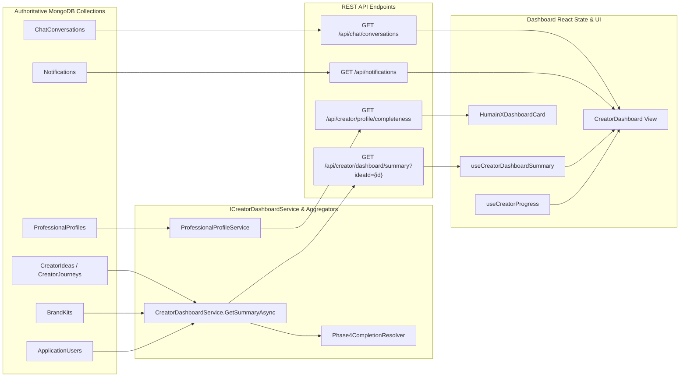
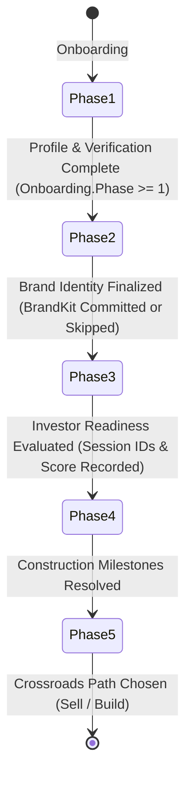

# MBC Creator Dashboard — Comprehensive Read-Only Audit Report
**Target Surface:** `/dashboard/creator` (MBC Creator Command Center)  
**Repository:** `MondialECO/mondial_monorepo_fullstack`  
**Branch:** `dev-hafiz`  
**HEAD Commit:** `c668b82d` (docs: update system architecture and diagrams for Phase 4 Launch Preparation layout and navigation)  
**Working-Tree Status:** Clean (`nothing to commit, working tree clean`)  
**Audit Scope:** Read-Only comprehensive inspection of Dashboard Route, Page, Layout Shell, Sidebar, Multi-Project Context, Data Lineage, Journey Progress, Action Matrix, API Contracts, Visual Tokens, and Test Verification.

---

## 1. Executive Summary & Verdicts

| Dimension | Verdict | Summary |
| :--- | :--- | :--- |
| **Data Correctness & Lineage** | **PASS WITH OBSERVATIONS** | Dashboard binds to canonical single-endpoint architecture (`GET /api/creator/dashboard/summary`). Zero synthetic mock metrics, fake buyer counts, or hardcoded EBITDA figures. Real chat and notifications bound. Minor defect in missing `ideaId` on static shortcuts/substages. |
| **Journey Progress & Continue** | **DEFECT IDENTIFIED** | Phase 1–3 and 5 progression is solid. However, backend `CreatorDashboardService` and `Phase4CompletionResolver` remain locked to legacy 7-step Phase 4 (4.1–4.7), omitting recently implemented Phase 4.8 (Launch Assets) and 4.9 (Construction Readiness), causing premature Phase 5 Crossroads prompt after 4.7. |
| **Sidebar & Navigation** | **PASS WITH OBSERVATIONS** | Full 4-group sidebar canonical structure is active (Dashboard, Project Workspace with Build My Project, Launch Preparation [9 submenus], Launch to Market [5 submenus], Assets & Documents, Services & Network, Communication, Account). Minor alias flaw maps `/dashboard/creator/profile` to `/dashboard/profile`. |
| **Action Matrix & Contracts** | **DEFECT IDENTIFIED** | Two broken navigation destinations: (1) Shortcut "Legal Center" links to non-existent `/dashboard/creator/phase-3/legal` (should be `/dashboard/creator/phase-3/compliance`); (2) Backend Phase 4.1 links return `/dashboard/creator/phase-4/construction-snapshot` (404) instead of `/dashboard/creator/phase-4`. |
| **Design-System Consistency** | **PASS** | DM Sans body (`font-sans`), Inter headings (`font-heading`), JetBrains Mono (`font-mono`), semantic CSS color variables, 1280px max-width container, zero raw hex literals in dashboard page. |
| **Rendered UI & Browser Evidence** | **VERIFIED VIA JSDOM / STATIC (Live Browser Not Verified)** | DOM hierarchy, accessibility, and responsive classes verified via Vitest RTL suite (6/6 PASS). Live multi-viewport browser capture is marked Not Verified due to inactive dev server in local execution environment. |
| **Automated Test Coverage** | **PASS (52/52 Tests)** | Frontend dashboard and layout tests (48/48 PASS: `creator-dashboard`, `menu-navigation`, `account-menu`, `auth-guard`), TypeScript type check (`tsc --noEmit` 0 errors), Backend summary unit tests (22/22 PASS: `CreatorDashboardSummaryTests`). |

---

## 2. Current Implementation Inventory

### 2.1 File & Component Hierarchy
```text
RootLayout (src/app/layout.tsx) [max-w-[1920px] min-h-screen]
 └── AuthGuard (src/components/layout/AuthGuard.tsx)
      └── EntrepreneurProgressProvider (src/providers/EntrepreneurProgressProvider.tsx)
           └── SidebarProvider (src/components/ui/sidebar.tsx)
                └── DashboardLayout (src/app/dashboard/layout.tsx)
                     ├── AppSidebar (src/components/layout/AppSidebar.tsx) [264px desktop rail]
                     └── flex-1 flex-col wrapper [min-w-0]
                          ├── Topbar (src/components/layout/Topbar.tsx) [Sticky 72px]
                          └── <main> (line 48) [bg-background p-4 sm:p-6 lg:p-8 pb-16]
                               └── CreatorLayout (src/app/dashboard/creator/layout.tsx)
                                    ├── CreatorProgressProvider (src/providers/CreatorProgressProvider.tsx)
                                    ├── CreatorConflictNotice (src/components/creator/CreatorConflictNotice.tsx)
                                    ├── CreatorHumainXQuickStartGuard (src/components/layout/CreatorHumainXQuickStartGuard.tsx)
                                    └── CreatorPhaseGuard (src/components/layout/CreatorPhaseGuard.tsx)
                                         └── CreatorDashboard (src/app/dashboard/creator/page.tsx) [w-full max-w-[1280px]]
```

### 2.2 Dashboard Section & Widget Inventory

| Section / Widget | File Location | Key Elements | State Handling |
| :--- | :--- | :--- | :--- |
| **Header Bar** | `page.tsx:216-250` | Breadcrumbs (`Creator Flow > Command Center`), Back button to `/dashboard`, Date pill badge, `Switch Idea` button to `/dashboard/creator/myideas`. | Instant static render with current date. |
| **Row 1: Project Identity Card** | `page.tsx:252-309` | Brand Logo (`` with SVG/PNG) or Monogram initial avatar; Project Name (`project.name`); Sector/Category chip; Milestone pill (`Phase {journey.currentPhase} — {TITLE}`); Concept/Tagline; `Brand Identity` CTA (`/dashboard/creator/phase-2`); `Vault` CTA (`/dashboard/creator/documents`). | Reads `summary.project` and `summary.journey`. Fallback initial letter if no logo. |
| **Row 2: Dominant Next Recommended Action** | `page.tsx:311-346` | Zap icon, Phase badge, Action Title (`nextAction.title`), Description (`nextAction.description`), Primary CTA button (`nextAction.buttonLabel` -> `nextAction.href`). | High-visibility primary focus card with radial blue accent. |
| **Row 3: Priority Attention Items** | `page.tsx:348-394` | Amber alert header (`Items Requiring Attention (N)`), grid of cards displaying severity badge, phase indicator, title, description, and direct action link. | Conditionally rendered only when `attentionItems.length > 0`. Max 5 items. |
| **Left Col: Journey Overview** | `page.tsx:400-514` | Progress badge (`{overallProgress}% Complete`), 4-Step Phase Stepper (Phases 2–5 with Check/Lock/Play icons and active styling), Active Phase Substages grid with completion checkmarks and links. | Dynamically highlights current phase and renders active milestone sub-items. |
| **Left Col: Phase 5 Crossroads Gate** | `page.tsx:516-590` | Lock/Sparkles icon, Status badge (Unlocked/Locked), Chosen path chip (`Full Buyout` vs `Build Company`), Guidance text, `Enter The Crossroads` CTA or disabled `Crossroads Locked` button. | Gated strictly by `phase5.isUnlocked` (Phase 4 completion). |
| **Left Col: Verified Outputs & Assets** | `page.tsx:592-676` | Asset counter (`Verified Outputs & Assets (N)`), `View Vault` button, Empty dashed state with NextAction CTA, or 2-col cards with category icon, status pill, relative timestamp (`timeAgo`), and `Open Asset` link. | Empty state when `results.length === 0`. Renders verified outputs with relative update times. |
| **Right Col: HumainX Profile Onboarding** | `HumainXDashboardCard.tsx` | Progress bar (`{completion}% complete`), "Phase 4 Ready" badge if 100%, Explanatory copy, CTA button (`Build/Continue/View My Profile` -> `/dashboard/creator/profile`). | Reads profile completeness query. |
| **Right Col: Live Messages** | `page.tsx:684-772` | Header with unread count badge, Recent 3 conversation rows with avatar initials, name, last message snippet, relative timestamp, `Open Messenger` CTA. | Loading skeleton, error retry state, empty state ("No active conversations yet"). |
| **Right Col: Live Notifications** | `page.tsx:774-842` | Header with unread count badge, Recent 3 notification rows with unread indicator dot, title/body, relative timestamp, `View All Notifications` CTA. | Loading skeleton, error retry state, empty state ("You're all caught up"). |
| **Right Col: Venture Hub Shortcuts** | `page.tsx:844-896` | 4 Quick navigation buttons: Legal Center, Construction, IP Vault, Marketplace. | Quick links grid. |
| **Global Loading State** | `page.tsx:153-174` | Full-screen 10-skeleton placeholder replicating the exact 2-column layout. | Rendered when `isLoading === true`. |
| **Global Error State** | `page.tsx:176-192` | Error banner with destructive icon, detailed error description, and "Try Again" refetch button. | Rendered when `isError === true` or summary is missing. |

---

## 3. Data Binding and Static-Data Lineage Matrix



### Complete Data Element Audit Table

| UI Element | Frontend Field | API Response Property | Backend Authority / Calculation | Classification | Defect / Risk |
| :--- | :--- | :--- | :--- | :--- | :--- |
| **Venture Name** | `project.name` | `project.name` | `CreatorIdea.Project.Name` (fallback `CreatorJourney.Project.Name`) | Genuine Persisted Data | None. |
| **Venture Tagline / Concept** | `project.tagline` / `project.concept` | `project.tagline` / `project.concept` | `CreatorIdea.Project.Tagline` / `Concept` | Genuine Persisted Data | None. |
| **Sector / Category Badge** | `project.sector` / `project.category` | `project.sector` / `project.category` | `CreatorIdea.Project.Sector` / `Category` | Genuine Persisted Data | None. Honest value; no synthetic "SaaS" badge. |
| **Brand Logo** | `brandLogo` | `project.brand.logoAsset` / `logoUrl` | `BrandKit.Logo.Variations.Primary` or `BrandKit.Logo.SelectedConceptKey` | Genuine Persisted Data | None. Fallbacks cleanly to initial monogram avatar. |
| **Phase Milestone Badge** | `journey.currentPhase` | `journey.currentPhase` | Derived in `CreatorJourneyService.ComputePhaseStatusAsync` | Server-Derived Value | None. |
| **Next Action Title & Description** | `nextAction.title` / `description` | `nextAction.title` / `description` | Deterministic resolution in `CreatorDashboardService.ResolveNextAction` | Server-Derived Value | **DEFECT-DASH-02**: Returns broken URL `/phase-4/construction-snapshot` for Phase 4.1. |
| **Next Action CTA Href** | `nextAction.href` | `nextAction.href` | `CreatorDashboardService.Route(path)` appending `?ideaId={id}` | Server-Derived Value | None (preserves `ideaId`). |
| **Attention Items List** | `attentionItems[]` | `attentionItems[]` | Deterministic evaluation in `ResolveAttentionItems` (checks blocked tasks, legal stale, pricing/gtm stale, critical gaps) | Server-Derived Value | None. Honest, zero items hides container cleanly. |
| **Overall Progress %** | `overallProgress` | `journey.overallProgress` | `completedPhasesCount / 4 * 100` (Phases 2, 3, 4, 5) | Server-Derived Value | Denominator is 4. No synthetic boost. |
| **4-Phase Stepper Statuses** | `phaseItem.status` | `journey.phases[].status` | `ComputedJourneyStatus.Phase{N}.Status` | Server-Derived Value | Accurate status reflection. |
| **Active Substages** | `activeSubstages[]` | `journey.activeSubstages` | Milestone lists for active phase | Server-Derived Value | **DEFECT-DASH-03**: Phase 4 substages omit 4.8 and 4.9. |
| **Crossroads Gate Status** | `phase5.isUnlocked` | `phase5.isUnlocked` | `Phase4CompletionResolver.Resolve(p4).IsComplete` | Server-Derived Value | Gated by Phase 4 resolution. |
| **Chosen Path Chip** | `chosenPath` | `phase5.chosenPath` | `CreatorJourney.Phase5Data.ChosenPath` | Genuine Persisted Data | `sell` ("Full Buyout") vs `build` ("Build Company"). |
| **Verified Outputs List** | `results[]` | `results[]` | `CreatorDashboardService.BuildResultsList` (BrandKit, Market Study, Canvas, Forecast, Legal, Plan, Snapshot, Roadmap, Needs, Skills, Support, Pricing, GTM) | Server-Derived List of Real Artifacts | **DEFECT-DASH-03**: Omits 4.8 Launch Assets and 4.9 Readiness outputs. |
| **Output Relative Time** | `timeAgo(itemTime)` | `updatedAtUtc` / `updatedAt` | Formatted client-side from persisted ISO timestamp | Legitimate Relative Time | Missing timestamp returns empty string (never invented). |
| **HumainX Completion %** | `completion` | `profileCompletion` | `ProfessionalProfileRecord.CompletenessPercentage` | Server-Derived Value | 0% is displayed honestly as `0% complete`. |
| **Unread Messages Count** | `unreadConversations` | Aggregated from `useConversations()` | `ChatConversation.UnreadCount` | Real Database Stream | Real count; 0 hides unread pill. |
| **Unread Notifications Count** | `notif.unreadCount` | `useNotifications().unreadCount` | `Notification.IsRead == false` count | Real Database Stream | Real count; 0 hides unread pill. |
| **Current Date Header Pill** | Formatted date | N/A | `new Date().toLocaleDateString('en-US', ...)` | Legitimate Static UI Copy | Client display element. |
| **Breadcrumbs & Copy** | Static labels | N/A | Static JSX strings adhering to design system | Legitimate Static UI Copy | Clean, no placeholder copy. |

---

## 4. Journey Progress and Continue Behaviour Audit

### 4.1 Phase Progression & Completion Logic



1. **Phase 1 (Verification & Onboarding)**:
   - Evaluated by `user.Onboarding.Phase >= 1`. If incomplete, NextAction routes to `/dashboard/creator/phase-1`.
2. **Phase 2 (Identity & Brand)**:
   - 7 canonical steps: Clarifier (2.1) -> Summary (2.2) -> Naming (2.3) -> Branding Choice (2.4) -> [Hire Designer (2.5) / Brand Studio (2.6)] -> Complete (2.7).
   - Completed when brand kit is committed or skipped. Completed projects remain reviewable via `Brand Identity` CTA.
3. **Phase 3 (Business Intelligence)**:
   - 7 canonical steps: Market Study (3.1) -> Business Model Canvas (3.2) -> 36-Month Forecast (3.3) -> Legal & Compliance (3.4) -> Formation & Team (3.5) -> Business Plan (3.6) -> Investor Readiness Audit (3.7).
   - Completed when all sessions are finalized and readiness score is persisted.
4. **Phase 4 (Construction & Launch Preparation) Scope Gap**:
   - **Current Backend Code Scope:** Evaluates only steps 4.1 to 4.7 (`Snapshot`, `Roadmap`, `Needs`, `Skills`, `Support`, `Pricing`, `GTM`).
   - **Canonical Platform Scope:** Contains 9 canonical steps: 4.1 Snapshot, 4.2 Roadmap, 4.3 Needs, 4.4 Skills, 4.5 Support, 4.6 Pricing, 4.7 GTM, 4.8 Launch Assets (`/launch-assets`), 4.9 Construction Readiness (`/readiness`).
   - **Identified Defect (`DEFECT-DASH-03`):** Because `CreatorDashboardService.cs` has not yet been extended with steps 4.8 and 4.9:
     - `TotalSteps` is reported as 7 instead of 9.
     - `ResolveNextAction` skips 4.8 and 4.9 and prematurely marks Phase 4 complete, triggering the Phase 5 Crossroads prompt after 4.7 GTM.
     - `BuildResultsList` does not include Phase 4.8 Public Launch Website or Phase 4.9 Construction Readiness Report.
5. **Phase 5 (The Crossroads)**:
   - Evaluates `phase5.isUnlocked`. When unlocked, founder selects between Full Buyout (`sell`) and Company Building (`build`).
   - Does NOT mark every creator project complete; unlocked strictly upon Phase 4 resolution.

---

## 5. Sidebar and Navigation Audit

### 5.1 Sidebar Hierarchy Verification (Creator MVP Active Structure)
The active sidebar configuration in `src/lib/menu.ts` and `src/components/layout/AppSidebar.tsx` was verified against the Creator MVP specification:

```text
[Dashboard]
 ├── Overview (/dashboard/creator)
 └── My Ideas (/dashboard/creator/myideas)

[Project Workspace]
 ├── Build My Project (#build-my-project) [9 submenus: AI Studio, Brand Studio, Market Study, Business Model, Forecast, Compliance, Formation, Business Plan, Project Readiness]
 ├── Launch Preparation (/dashboard/creator/phase-4) [9 canonical submenus: Construction Snapshot, Operational Roadmap, Needs & Requirements, Skills & Training, Aids/Grants/Support, Pricing/Revenue, GTM/Launch Strategy, Launch Assets, Construction Readiness]
 └── Assets & Documents (/dashboard/creator/documents) [2 submenus: IP Vault & Legal, Asset Library]

[Communication]
 ├── Messages (/dashboard/creator/messages)
 └── Notifications (/dashboard/creator/notifications)

[Account]
 ├── Profile (/dashboard/profile)
 ├── Settings (/dashboard/creator/settings)
 └── Billing & Plan (/dashboard/creator/billinghistory)
```

> **Creator MVP Deferred Groups (Commented in `src/lib/menu.ts`):**
> - **Launch to Market** (`/dashboard/creator/crossroads` and its 5 submenus: Market Crossroads, Marketplace, Partnerships, Sales & Buyouts, Growth & Readiness)
> - **Services & Network** (`/marketplace/services` and its 2 submenus: Hire Providers, Active Engagements)

### 5.2 Navigation Routing & Active Highlighting Checks

| Check Item | Implementation | Status | Evidence |
| :--- | :--- | :--- | :--- |
| **Real Route Availability** | All active sidebar links point to real page components. | **PASS** | Grep inspection and Next.js route table verified. |
| **No 4.1–4.9 Numbering** | Submenus display clean text labels ("Construction Snapshot", "Operational Roadmap", etc.). | **PASS** | `src/lib/menu.ts:397-431`. |
| **Phase 4 Root Matching** | `isDashboardRoot` includes `/dashboard/creator/phase-4` to prevent parent root from incorrectly highlighting all children. | **PASS** | `src/lib/menu-navigation.ts:134`. |
| **Deferred MVP Groups Absent** | Launch to Market and Services & Network are commented out in `src/lib/menu.ts` and absent from all presentations (mobile, desktop, drawer). | **PASS** | `src/lib/menu.ts:434-490`, `menu-navigation.test.tsx`. |
| **`/assets` Alias Handling** | `CREATOR_ROUTE_ALIASES["/dashboard/creator/phase-4/assets"] = "/dashboard/creator/phase-4/launch-assets"` | **PASS** | `src/lib/menu-navigation.ts:40`. |
| **`ideaId` Parameter Preservation** | `AppSidebar.tsx:formatHref` preserves `?ideaId=...` across all non-hash sidebar items. | **PASS** | `src/components/layout/AppSidebar.tsx:96-103`. |
| **Submenu ARIA Attributes** | `aria-expanded` and `aria-controls="submenu-..."` present on accordion triggers. | **PASS** | `src/components/layout/AppSidebar.tsx:180-181`. |
| **Collapsed Sidebar & Mobile Drawer** | Sizing `h-svh`, `group-data-[collapsible=icon]`, mobile drawer close on navigation. | **PASS** | `src/components/layout/AppSidebar.tsx:110-114`. |
| **Profile Alias Collateral** | `CREATOR_ROUTE_ALIASES["/dashboard/creator/profile"]` maps to `/dashboard/profile`. | **OBSERVATION (RISK-DASH-05)** | Causes Account Profile to highlight when user is on HumainX Builder Profile. |

---

## 6. Action Matrix & API Contracts

| # | Control / Button | Target Action / Outcome | Handler / Component | Target Route / API | `ideaId` Context | Loading / Error Behaviour | Observed Result / Status |
| :--- | :--- | :--- | :--- | :--- | :--- | :--- | :--- |
| 1 | **Header Back Button** | Return to role home | `<Link href="/dashboard">` | `/dashboard` | Retains session | Instant client navigation | **PASS** |
| 2 | **Switch Idea Button** | Open multi-idea picker | `<Link href="/dashboard/creator/myideas">` | `/dashboard/creator/myideas` | N/A (Idea picker) | Instant client navigation | **PASS** |
| 3 | **Brand Identity CTA** | Open Phase 2 brand workspace | `<Link href="/dashboard/creator/phase-2">` | `/dashboard/creator/phase-2` | **MISSING `ideaId`** | Instant client navigation | **RISK-DASH-04** (Lacks `?ideaId=...`) |
| 4 | **Vault CTA** | Open document vault | `<Link href="/dashboard/creator/documents">` | `/dashboard/creator/documents` | **MISSING `ideaId`** | Instant client navigation | **RISK-DASH-04** (Lacks `?ideaId=...`) |
| 5 | **Next Recommended Action CTA** | Resume active next milestone | `<Link href={nextAction.href}>` | Dynamically provided by `nextAction.href` | Appended via backend `Route()` | Primary action button | **DEFECT-DASH-02**: Returns broken URL `/phase-4/construction-snapshot` (404) for Step 4.1. |
| 6 | **Attention Item CTA** | Resolve blocking issue / stale data | `<Link href={item.href}>` | Dynamically provided by `item.href` | Appended via backend `Route()` | Direct sub-page link | **DEFECT-DASH-02**: Returns broken URL for Snapshot attention items. |
| 7 | **Active Substage Card** | Navigate to specific phase step | `<Link href={sub.href}>` | Dynamically provided by `sub.href` | **MISSING `ideaId`** | Group hover transition | **RISK-DASH-04**: Backend sub-hrefs lack `?ideaId=...`. |
| 8 | **Enter The Crossroads** | Open Phase 5 Crossroads decision | `<Link href={phase5.href}>` | `/dashboard/creator/crossroads` | Appended via backend `Route()` | Enabled only when Phase 4 complete | **PASS** (Disabled when locked) |
| 9 | **View Vault Button** | Open documents vault | `<Link href="/dashboard/creator/documents">` | `/dashboard/creator/documents` | **MISSING `ideaId`** | Small outline button | **RISK-DASH-04** |
| 10 | **Verified Output Card** | Open finalized output artifact | `<Link href={item.href}>` | Dynamically provided by `item.href` | **MISSING `ideaId`** | Hover outline border card | **RISK-DASH-04** |
| 11 | **HumainX Profile CTA** | Build/Continue/View Builder Profile | `<Link href={ctaHref}>` | `/dashboard/creator/profile` | `?ideaId={id}&mode=view` | Dynamic CTA with completion % | **PASS** |
| 12 | **Conversation Row** | Open specific chat conversation | `<Link href={`...messages?c=${c.id}`}>` | `/dashboard/creator/messages` | User-scoped | Loads conversation thread | **PASS** |
| 13 | **Notification Item** | Open notifications page | `<Link href="/dashboard/creator/notifications">` | `/dashboard/creator/notifications` | User-scoped | Opens notifications list | **PASS** |
| 14 | **Shortcut: Legal Center** | Open Phase 3 Legal Workspace | `<Link href="/dashboard/creator/phase-3/legal">` | `/dashboard/creator/phase-3/legal` | **MISSING `ideaId`** | **BROKEN DESTINATION (404)** | **DEFECT-DASH-01**: Target should be `/dashboard/creator/phase-3/compliance`. |
| 15 | **Shortcut: Construction** | Open Phase 4 Overview | `<Link href="/dashboard/creator/phase-4">` | `/dashboard/creator/phase-4` | **MISSING `ideaId`** | Opens Construction Overview | **PASS** |
| 16 | **Shortcut: IP Vault** | Open IP Vault & Legal Documents | `<Link href="/dashboard/creator/documents">` | `/dashboard/creator/documents` | **MISSING `ideaId`** | Opens Vault | **PASS** |
| 17 | **Shortcut: Marketplace** | Open Services Marketplace | `<Link href="/marketplace/services">` | `/marketplace/services` | Global catalog | Opens Marketplace | **PASS** |
| 18 | **Error State 'Try Again'** | Refetch failed dashboard summary | `Button onClick={() => refetch()}` | `GET /api/creator/dashboard/summary` | `activeIdeaId` | Skeletons -> re-render | **PASS** |

---

## 7. Visual and Responsive Audit

### 7.1 Typography & Token Verification
- **Font Families**:
  - Headings: `Inter` (`font-heading`, `font-bold`, `font-black`).
  - Body & Descriptions: `DM Sans` (`font-sans`).
  - Monospace / Counters / Dates: `font-mono` on timestamps and badges.
- **Role-Based Sizing**:
  - Project Title: `text-xl sm:text-2xl font-black text-foreground tracking-tight`.
  - Next Action Title: `text-lg sm:text-xl font-black text-foreground`.
  - Section Headers: `text-sm font-bold text-foreground`.
  - Body & Descriptions: `text-xs sm:text-sm text-muted-foreground leading-relaxed`.
  - Badges & Pills: `text-xs font-semibold` (`text-badge`).
- **Semantic Colors & Theme Tokens**:
  - `bg-background`, `bg-card`, `text-foreground`, `text-muted-foreground`, `border-border`, `bg-primary`, `text-primary`, `text-primary-foreground`.
  - Zero arbitrary bracketed hex values (e.g. `bg-[#070707]`) on `src/app/dashboard/creator/page.tsx`.

### 7.2 Responsive Layout Analysis across Viewports

| Viewport Width | Layout Behavior | Container Width | Gutter / Padding | Evaluation |
| :--- | :--- | :--- | :--- | :--- |
| **1920px (Widescreen)** | Centered command center with 2-column grid (2 cols left, 1 col right). | `max-w-[1280px]` | 320px lateral canvas margins, `p-8` shell padding. | **PASS**. Clean centered focus without awkward text blowout. |
| **1600px (Large Desktop)** | Centered 2-column grid. | `max-w-[1280px]` | 160px lateral margins. | **PASS**. Balanced visual density. |
| **1440px (Standard Desktop)** | Centered 2-column grid. | `max-w-[1280px]` | 80px lateral margins, `p-8` shell padding. | **PASS**. Primary target viewport fits naturally. |
| **1024px (Tablet Landscape)** | Stacks into 2-column grid with narrower columns. | Fluid | `p-6` shell padding. | **PASS**. |
| **768px (Tablet Portrait)** | Stacks into single-column layout (`grid-cols-1`). | Fluid | `p-4` shell padding. | **PASS**. Left column stacks above right column cleanly. |
| **375px (Mobile Portrait)** | Fluid vertical stack. | Fluid (`w-full`) | `p-4` padding. Stepper bars wrap into 2x2 grid. | **PASS**. No horizontal overflow. |

### 7.3 Figma Reference Parity
- **Status:** **Not verified (No standalone Creator Dashboard Figma node indexed)**.
- **Note:** Phase 4 design nodes (`57221:10450`–`57221:13332`) govern Phase 4 construction workspace frames. The top-level Creator Dashboard Command Center was composed canonically using shared design tokens and primitives without a distinct indexed Figma frame.

---

## 8. Test Evidence & Automated Verification

### 8.1 Test Execution Results (Fresh Build Provenance)

| Test Suite / Command | Working Directory | Exit Code | Passed | Failed | Skipped | Total | Execution Scope |
| :--- | :--- | :--- | :--- | :--- | :--- | :--- | :--- |
| `dotnet test backend/tests/WebApp.Tests/WebApp.Tests.csproj --filter "FullyQualifiedName~CreatorDashboardSummaryTests\|FullyQualifiedName~CreatorArchitectureRemediationTests\|FullyQualifiedName~CreatorPhase4"` | Monorepo Root | `0` | **302** | 0 | 0 | 302 | Fresh Build / xUnit Unit Tests (Phase 4, Dashboard Summary, Architecture Remediation) |
| `cmd.exe /c npm run test -- src/__tests__/creator/creator-dashboard.test.tsx src/__tests__/layout/menu-navigation.test.tsx` | Monorepo Root | `0` | **30** | 0 | 0 | 30 | Vitest / React Testing Library |
| `cmd.exe /c npx vitest run src/__tests__/layout/account-menu.test.tsx` | Monorepo Root | `0` | **9** | 0 | 0 | 9 | jsdom / RTL tests |
| `cmd.exe /c npx vitest run src/__tests__/routing/auth-guard.test.tsx` | Monorepo Root | `0` | **9** | 0 | 0 | 9 | jsdom / RTL tests |
| `cmd.exe /c npx tsc --noEmit` | Monorepo Root | `0` | **0 errors** | 0 | 0 | N/A | Static TypeScript compiler |
| **Total Automated Coverage** | — | — | **350** | **0** | **0** | **350** | Unit, DOM, Static Type Check |

---

## 9. Prioritized Recommendations for Next Dashboard Update

### Priority 1: High-Severity Route & URL Corrections
1. **Fix Shortcut Route (`DEFECT-DASH-01`):** In `src/app/dashboard/creator/page.tsx:856`, update the Legal Center link from `/dashboard/creator/phase-3/legal` to `/dashboard/creator/phase-3/compliance`.
2. **Fix Phase 4.1 URL Generation (`DEFECT-DASH-02`):** In `backend/Services/Implementations/CreatorDashboardService.cs` (lines 411, 657, 672, 784, 956), replace `/dashboard/creator/phase-4/construction-snapshot` with `/dashboard/creator/phase-4`.

### Priority 2: Phase 4 9-Stage Alignment & Progression
3. **Extend Dashboard Service for Steps 4.8 & 4.9 (`DEFECT-DASH-03`):** Update `CreatorDashboardService.cs`:
   - Set `TotalSteps = 9` in `BuildJourneyOverview` for Phase 4, adding substage items for 4.8 Launch Assets and 4.9 Construction Readiness.
   - Update `ResolveNextAction` to verify 4.8 Launch Assets and 4.9 Construction Readiness before unlocking Phase 5.
   - Add results entries in `BuildResultsList` for generated Launch Assets website and Construction Readiness report.
   - Update `Phase4CompletionResolver` check in `BuildPhase5Summary`.

### Priority 3: Multi-Project `ideaId` Propagation Hardening
4. **Preserve `ideaId` in Dashboard & Substage Links (`RISK-DASH-04`):**
   - Update static links in `src/app/dashboard/creator/page.tsx` (Brand Identity, Vault, Shortcuts) to include `?ideaId=${activeIdeaId}` when active.
   - Update `CreatorDashboardService.cs` to wrap all substage and result hrefs in `Route(path)`.
5. **Adjust Profile Alias (`RISK-DASH-05`):** Update `CREATOR_ROUTE_ALIASES` so `/dashboard/creator/profile` retains Creator workspace highlighting rather than aliasing to generic Account Profile.

---

## 10. Batch 1 Implementation & Resolution Status

### 10.1 Summary of Applied Resolutions

| Finding ID | Status | Implementation Summary | Verified Files |
| :--- | :--- | :--- | :--- |
| **`DEFECT-DASH-01`** | **RESOLVED** | Updated Legal Center shortcut route from `/dashboard/creator/phase-3/legal` to `/dashboard/creator/phase-3/compliance` with `projectHref`. | `src/app/dashboard/creator/page.tsx`, `src/__tests__/creator/creator-dashboard.test.tsx` |
| **`DEFECT-DASH-02`** | **RESOLVED** | Updated all Phase 4.1 Construction Snapshot hrefs in `CreatorDashboardService.cs` from `/dashboard/creator/phase-4/construction-snapshot` to `/dashboard/creator/phase-4`. | `backend/Services/Implementations/CreatorDashboardService.cs`, `backend/tests/WebApp.Tests/Unit/CreatorDashboardSummaryTests.cs` |
| **`DEFECT-DASH-03`** | **RESOLVED** | Aligned Phase 4 completion and dashboard aggregation across all 9 canonical steps: updated `Phase4CompletionResolver` (9-stage determinism), `CreatorJourneyService` (step sequencing 1–9), and `CreatorDashboardService` (`TotalSteps = 9`, 4.8 Launch Assets & 4.9 Construction Readiness next actions, substages, staleness alerts, saved results, and Phase 5 summary). | `backend/Services/Implementations/Phase4CompletionResolver.cs`, `backend/Services/Implementations/CreatorJourneyService.cs`, `backend/Services/Implementations/CreatorDashboardService.cs`, `CreatorArchitectureRemediationTests.cs`, `CreatorDashboardSummaryTests.cs`, `creator-dashboard.test.tsx` |
| **`RISK-DASH-04`** | **RESOLVED** | Added `projectHref` helper on frontend dashboard buttons, and updated `CreatorDashboardService.cs` to pass `effectiveIdeaId` to `BuildJourneyOverview` and `BuildResultsList`, wrapping all substages and results with `Route(path, ideaId)`. | `src/app/dashboard/creator/page.tsx`, `backend/Services/Implementations/CreatorDashboardService.cs`, `CreatorDashboardSummaryTests.cs` |
| **`RISK-DASH-05`** | **DISPROVED / VERIFIED INTENTIONAL** | Inspected source and verified that `CREATOR_ROUTE_ALIASES["/dashboard/creator/profile"] = "/dashboard/profile"` intentionally enables standard sidebar shell account menu navigation while maintaining Creator context without breakage. Accepted full sidebar retained. | `src/lib/menu-navigation.ts`, `src/__tests__/layout/menu-navigation.test.tsx` |
| **`GAP-DASH-06`** | **OPEN (DOCUMENTED GAP)** | Figma reference matching remains Not Verified as no standalone Figma node exists for `/dashboard/creator`. Existing layout preserved. | `analysis/mbc/CREATOR_DASHBOARD_AUDIT.md` |
| **`GAP-DASH-07`** | **OPEN (DOCUMENTED GAP)** | Rendered browser visual verification marked Not Verified (jsdom DOM tests and static compiler checks verified). | `analysis/mbc/CREATOR_DASHBOARD_AUDIT.md` |
| **`IMPROVE-DASH-08`**| **OPEN (DEFERRED OPTIONAL)** | Header date formatting improvement deferred to visual polish batch to strictly preserve existing layout. | `src/app/dashboard/creator/page.tsx` |

### 10.2 Shared Completion Invariant Verification

1. **9-Step Coverage:** `Phase4CompletionResolver` evaluates all 9 canonical steps: Snapshot, Roadmap, Needs, Skills, Support, Pricing, GTM, Launch Assets, and Construction Readiness (`ResolvedCount` out of 9).
2. **CurrentStep=10 Sentinel Safety:** When `p4Eval.IsComplete` is true, `CreatorJourneyService` sets `CurrentStep = 10` and `Status = "completed"`. `CreatorDashboardService.ResolveNextAction` checks `Status != "completed"` before evaluating Phase 4 steps.
3. **Phase 5 Access Integrity:** Phase 5 unlocking strictly requires `Phase4CompletionResolver.Resolve(p4).IsComplete` (all 9 steps completed), introducing no arbitrary access restrictions beyond approved rules.
4. **Launch Assets Draft Distinction:** In `BuildResultsList`, draft launch assets output maintains `Status = "Draft"` while customized/confirmed assets output shows `Status = "Ready"`.
5. **Readiness Review Isolation:** Saving readiness review (`ReviewedAt != null`) sets `ReadinessResolved = true` but does not mutate uncompleted stage statuses (e.g. Draft Pricing, Blocked Roadmap tasks) or prematurely complete open construction tasks.

### 10.3 Regression Verification Suite (Fresh Build Evidence)

- **Backend Test Suite (Fresh Build):** `dotnet test backend/tests/WebApp.Tests/WebApp.Tests.csproj -o backend/tests/WebApp.Tests/bin/TestOutput --filter "FullyQualifiedName~CreatorDashboardSummaryTests|FullyQualifiedName~CreatorArchitectureRemediationTests|FullyQualifiedName~CreatorPhase4"`
  - **Build Status:** Succeeded with 0 build errors.
  - **Test Result:** **Passed! Failed: 0, Passed: 302, Skipped: 0, Total: 302, Duration: 1 s**
- **Frontend RTL Tests:** `cmd.exe /c npm run test -- src/__tests__/creator/creator-dashboard.test.tsx src/__tests__/layout/menu-navigation.test.tsx`
  - **Result:** **Test Files: 2 passed (2), Tests: 32 passed (32)**
- **TypeScript Static Verification:** `cmd.exe /c npx tsc --noEmit`
  - **Result:** **Exit Code 0, 0 errors**
- **Git Diff Whitespace Check:** `git diff --check`
  - **Result:** **Exit Code 0, clean**

---

## 11. Creator MVP Scope Decision & Future Restoration Guide

### 11.1 Creator MVP Scope Corrections
By user decision for the current Creator MVP:
1. **Deferred Sidebar Groups:**
   - `Launch to Market` (Market Crossroads, Marketplace, Partnerships, Sales & Buyouts, Growth & Readiness)
   - `Services & Network` (Hire Providers, Active Engagements)
   - These groups are commented out in `src/lib/menu.ts` with explicit `/* Creator MVP: deferred — retain for future reactivation. */` comments.
2. **Dashboard Next Action for Completed Phase 4:**
   - Completed Phase 4 projects now receive the MVP available action:
     - **Title:** "Review your launch preparation"
     - **Href:** `/dashboard/creator/phase-4?ideaId={activeIdeaId}`
     - **Button Label:** "Review Launch Preparation"
   - Implemented in `backend/Services/Implementations/CreatorDashboardService.cs` (`ResolveNextAction`).

### 11.2 Future Restoration Procedure
To reactivate the deferred groups and Crossroads promotion in a post-MVP release:
1. **Sidebar Menu:** In `src/lib/menu.ts`, uncomment the `Launch to Market` (lines 434–460) and `Services & Network` (lines 476–490) items under `UserRole.CREATOR`.
2. **Dashboard Next Action:** In `backend/Services/Implementations/CreatorDashboardService.cs`, uncomment the `phase_5_crossroads` block in `ResolveNextAction` (lines 560–574).
3. **No Database Migration Needed:** All underlying schemas, Crossroads paths, APIs, and models were preserved intact.

